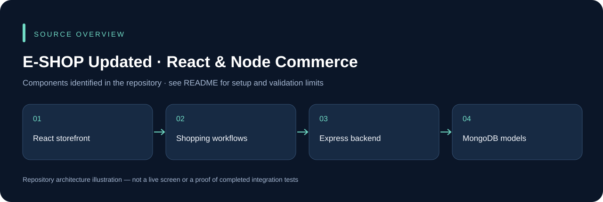

# E-SHOP Updated · React & Node Commerce

A commerce project pairing a React/Vite storefront with a Node.js Express/Mongoose backend. This is the React/Node variant; the separate `E-SHOP` repository uses a different backend stack.

## Run locally

```powershell
cd Frontent
npm ci
npm run dev
```

The directory is spelled **`Frontent`** in the repository. Configure the intended API address locally. In another terminal, enter `Backend`, run `npm ci`, provision its required environment variables from the example, and run `npm start`. Supply an isolated MongoDB database and any required mail/upload/service configuration.

The `Frontent/public` folder contains storefront assets. Generated browser debug captures and live `.env` files are not suitable deployment configuration. Product persistence, checkout, authentication and external services need end-to-end testing before operational use.

## Application preview


Captured from the actual frontend after fixing its missing react-bootstrap-icons dependency. MongoDB authentication, product fetching and checkout were not exercised. This is not a fabricated populated store.

## Source overview



This diagram is derived from the repository structure; it is not an application screenshot.

## Development and validation

Use an isolated development database and synthetic records. Keep credentials, device sessions, signing keys and operational uploads outside Git. The presence of source code does not establish that every integration or deployment scenario has been tested. See [repository review](docs/REPOSITORY_REVIEW.md) for this audit's scope.

## Ownership and contributions

Existing author, template, asset and dependency attributions remain in place. Follow any existing license files; this documentation update does not grant a new license. For a change, describe the affected workflow, configuration and checks so it can be reviewed without guessing.
