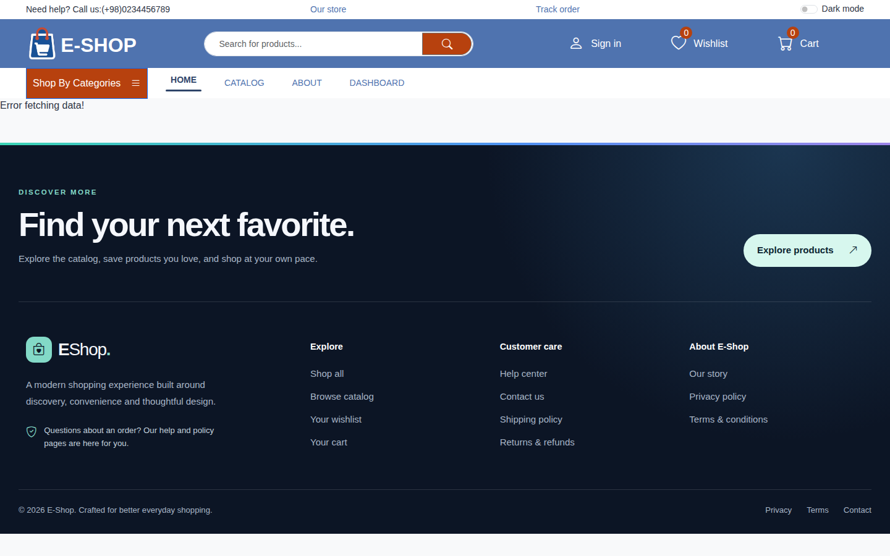
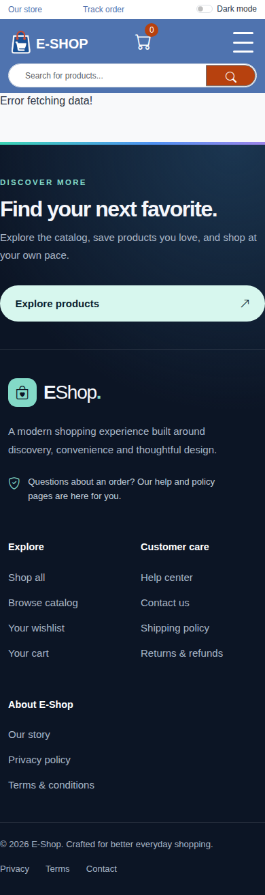
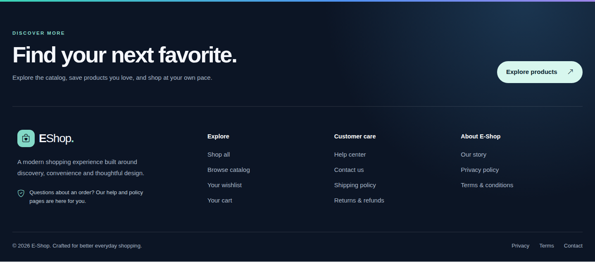
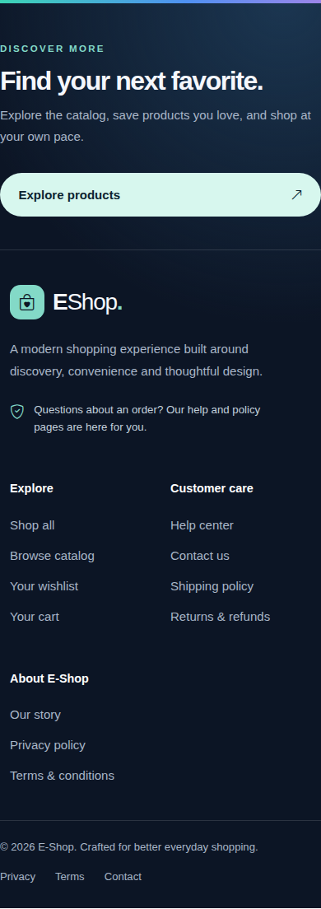
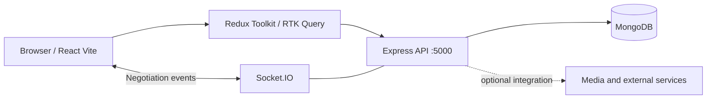

# E-SHOP UPDATED — Full-Stack E-Commerce Platform

A full-stack online storefront and product-management application built with **React, Vite, Redux Toolkit, React Bootstrap, Node.js, Express, MongoDB and Socket.IO**. The code includes product browsing, authentication, shopping cart operations, product reviews, seller/product administration and negotiation messaging. Some features require configured third-party services and have not been verified end-to-end.

[Quick start](#quick-start) · [Screenshots](#real-application-screenshots) · [Features](#features) · [Architecture](#architecture) · [Configuration](#configuration-and-security) · [Troubleshooting](#troubleshooting)

## Real application screenshots

These images are captured by **Chromium running the actual Vite frontend** in GitHub Actions, rather than mockups or AI-generated screens. They will appear once the screenshot workflow completes and commits the files. A frontend screenshot does not establish that database-backed flows are working.





### Redesigned responsive footer

The footer now includes an editorial shopping call-to-action, semantic navigation to actual application routes, responsive columns, keyboard-visible focus states, and reduced-motion support. These are real screenshots captured from the running frontend after the workflow succeeds:





### Header and catalog error handling

The header has a responsive, accessible product search field, improved navigation actions and corrected support links. When the API is unavailable, the homepage shows a helpful retry state instead of the raw `Error fetching data!` message, while the footer remains visible.

**Database diagnosis:** `Frontent/src/utils/apis.js` points to `http://localhost:5000/api`. The backend expects `MONGO_URI` and uses `Backend/Config/ConnectDB.js` for Mongoose. A GitHub Actions browser cannot access a MongoDB service on your own computer; running the frontend alone cannot populate products. Start MongoDB and the backend, verify `/api/products` and `/api/products/getcategories`, and inspect server logs without exposing credentials.

**Demo-data limitation:** CI can start the Vite frontend, but the MongoDB-backed catalog cannot be populated without a working backend and authorized database. Screenshots may show empty/loading product areas; they are not presented as evidence of populated production records. The footer itself is independent of database access.

[Frontend build and screenshot workflow](https://github.com/asimasgharali243/E-SHOP-UPDATED/actions/workflows/portfolio-frontend-build.yml)

## Features

| Area | Implementation found in source |
| --- | --- |
| Storefront | React pages, product cards, catalog, product details and search/filter interfaces |
| Accounts | Authentication routes for registration, login, logout, password recovery and verification |
| Shopping | Cart API, cart synchronization and product-related endpoints |
| Product management | Product creation, updates, deletion, reviews, likes and rollback endpoints |
| Negotiation | Negotiation routes and Socket.IO events for room membership and typing |
| Media and services | ImageKit, Cloudinary, email and other integrations referenced by backend dependencies |

**Implementation is not the same as verified production readiness.** Payment, external AI/media services and account workflows must be configured and tested with safe demo accounts.

## Tech stack

- **Frontend:** React 18, Vite 6, React Router, Redux Toolkit/RTK Query, React Bootstrap, Sass, Bootstrap Icons.
- **Backend:** Node.js, Express 4, Mongoose 8, Socket.IO, JWT-related dependencies.
- **Database:** MongoDB.
- **External integrations:** ImageKit and other optional services referenced by the source. Credentials are not included.

## Project layout

```text
E-SHOP-UPDATED/
├── Frontent/                # React + Vite client (folder spelling is intentional)
│   ├── src/
│   │   ├── components/      # Shared storefront and dashboard UI
│   │   ├── pages/           # Storefront, product and admin pages
│   │   ├── redux/           # State management and RTK Query APIs
│   │   └── utils/apis.js    # API URL configuration
│   └── package.json
├── Backend/                 # Express and MongoDB API
│   ├── Config/ConnectDB.js
│   ├── routes/
│   ├── app.js
│   ├── index.js
│   └── package.json
├── docs/
│   ├── ARCHITECTURE.md
│   ├── RUNBOOK.md
│   └── screenshots/
└── README.md
```

## Quick start

### Requirements

- Node.js **22** and npm (the CI frontend build uses Node 22).
- A reachable MongoDB database, local or hosted.
- Your own credentials for any optional third-party service you choose to enable.

### 1. Clone

```bash
git clone https://github.com/asimasgharali243/E-SHOP-UPDATED.git
cd E-SHOP-UPDATED
```

**Note:** The documentation and fixes described here are currently on the `docs/portfolio-professionalization-2026` review branch, not yet merged to `main`. To review this version:

```bash
git switch docs/portfolio-professionalization-2026
```

### 2. Configure the backend

```bash
cd Backend
npm install
cp .env.example .env
```

Edit `Backend/.env` with your own values. At minimum, the source reads `MONGO_URI`, and the backend's ImageKit initialization reads `IMAGEKIT_PUBLIC_KEY`, `IMAGEKIT_PRIVATE_KEY`, and `IMAGEKIT_URL_ENDPOINT`. Additional routes may require further credentials. **Do not commit `.env` or paste secrets into issues.**

```bash
npm start
```

The backend script currently runs `nodemon index.js`; the server defaults to **http://localhost:5000**. Successful startup requires a working database and valid configuration.

### 3. Start the frontend in a second terminal

```bash
cd E-SHOP-UPDATED/Frontent
npm ci
npm run dev -- --host 127.0.0.1 --port 3000
```

Open **http://localhost:3000**. Port 3000 matters: the checked-in backend CORS configuration permits `localhost:3000` and `127.0.0.1:3000`, while the frontend API helper currently targets `http://localhost:5000/api`.

To build and preview the frontend:

```bash
npm run build
npm run preview
```

The preview may render without backend data. Running a frontend build alone does **not** validate checkout, login, payments or other API flows.

## Architecture



The frontend API helper lives in `Frontent/src/utils/apis.js`. The backend registers `/api/auth`, `/api/products`, `/api/cart`, and `/api/negotiation` in `Backend/app.js`.

## Configuration and security

An environment file was previously tracked in this **public** repository. The review branch removes it from tracking and ignores future environment files, but **the old values may remain in Git history and must be treated as exposed**. Rotate/revoke all credentials previously stored there, review repository history, and perform a coordinated history purge if appropriate. Removing the current file is **not** sufficient to invalidate leaked keys.

Never put server secrets in Vite client code or screenshots. Use test accounts and sample product data for demonstrations.

## Troubleshooting

| Problem | Check |
| --- | --- |
| Browser shows CORS errors | Start the frontend on port **3000** and the backend on **5000**, or update both CORS and frontend configuration together |
| API requests fail | Check MongoDB connection, backend startup logs and `Frontent/src/utils/apis.js` |
| Empty product catalog | Verify the database has non-sensitive demo products and the `/api/products` endpoint works |
| Frontend build fails on Linux | File import casing must match filenames exactly; see CI logs |
| Third-party integration fails | Supply your own valid credentials through ignored local configuration |

## Quality, contribution and status

The [frontend CI workflow](.github/workflows/portfolio-frontend-build.yml) installs dependencies, builds the client and attempts real browser screenshot capture. Build and screenshot success must be checked in the [Actions runs](https://github.com/asimasgharali243/E-SHOP-UPDATED/actions). Full backend integration tests, security assessment and deployment validation remain open work.

For detailed notes, see [architecture](docs/ARCHITECTURE.md), [runbook](docs/RUNBOOK.md), [portfolio audit](docs/PORTFOLIO_AUDIT.md) and [screenshot guidance](docs/SCREENSHOT_GUIDE.md).

Contributions should include reproducible steps, appropriate tests and no secrets or private user data.

**Search terms:** MERN e-commerce application, React shopping cart, Express MongoDB API, React Redux Toolkit storefront, Node.js e-commerce dashboard, Socket.IO negotiation.
